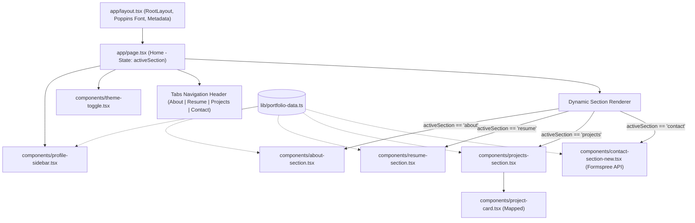

# GEMINI.md — Project Documentation & AI Modification Guide

> **Project:** Chanheng Menh Portfolio  
> **Repository:** `chanhengmenh/chanhengmenh`  
> **Primary Owner:** Chanheng Menh (Systems Engineer | AI Infrastructure Specialist | Cloud Infrastructure Engineer)  
> **Last Verified:** September 2026  

---

## 1. Project Overview & Architecture

This repository hosts the personal portfolio website for **Chanheng Menh**, showcasing his professional background in Digital Infrastructure, Systems Engineering, Cloud Infrastructure, AI/MLOps, and Backend Development.

### Key Architecture Characteristics
- **Architecture:** Client-side Single Page Application (SPA) with tabbed navigation (`About`, `Resume`, `Projects`, `Contact`) wrapped inside Next.js App Router.
- **Layout Structure:**
  - **Left Sidebar (`ProfileSidebar`):** Sticky card containing avatar photo, animated glowing border, contact quick-links (Email, Phone, Location), and external social links (GitHub, LinkedIn, Credly).
  - **Right Main Card:** Header tab bar switching between four interactive views (`AboutSection`, `ResumeSection`, `ProjectsSection`, `ContactSection`).
  - **Floating Controls:** Theme toggle button fixed at top-right for switching between dark and light modes.
- **Data-Driven UI:** Almost all content (profile info, bio, timeline, skills, projects, contact details) is centralized in `lib/portfolio-data.ts`. Modifying data there updates the entire site without touching JSX layout structures.

---

## 2. Tech Stack & Dependencies

| Category | Technology / Library | Version / Details |
| :--- | :--- | :--- |
| **Framework** | Next.js (App Router, Turbopack) | `16.2.9` |
| **Runtime & Core** | React / React DOM | `19.2.0` |
| **Language** | TypeScript | `^5` |
| **Styling** | Tailwind CSS v4 (`@tailwindcss/postcss`) | `^4.1.9` |
| **Animation** | `tw-animate-css`, custom CSS keyframes | `1.3.3` |
| **UI Primitives** | Radix UI primitives (`@radix-ui/*`) | shadcn/ui "new-york" style |
| **Icons** | `lucide-react`, `react-icons` (`react-icons/si`) | Simple Icons (Credly, etc.) |
| **Typography** | Poppins (`next/font/google`) | Variable font `--font-poppins` |
| **Form Handling** | Formspree endpoint | `https://formspree.io/f/mvzjrlpg` |
| **Analytics** | `@vercel/analytics` | `1.3.1` |
| **Package Manager** | `pnpm` (lockfile present, version `10.x`) | Compatible with `npm` |
| **Deployment** | Vercel | Configured via `vercel.json` |

---

## 3. Directory & File Structure Map

```text
chanhengmenh/
├── app/
│   ├── globals.css              # ACTIVE global styles: Tailwind v4 @import, OKLCH color vars, animations
│   ├── layout.tsx               # Root HTML layout, Poppins font injection, SEO/OG metadata, Vercel Analytics
│   └── page.tsx                 # Main SPA controller: tabs state, sidebar, and section rendering
│
├── components/
│   ├── about-section.tsx        # "About" tab: bio paragraphs
│   ├── contact-section-new.tsx  # ACTIVE "Contact" tab: Formspree form, interactive map iframe, contact cards
│   ├── contact-section.tsx      # LEGACY/INACTIVE contact component (kept for reference)
│   ├── hero-section.tsx         # Standalone hero component (optional/alternate view)
│   ├── profile-sidebar.tsx      # Fixed left sidebar: avatar, contact details, social links
│   ├── project-card.tsx         # Reusable card component for individual portfolio projects
│   ├── projects-section.tsx     # "Projects" tab: renders grid of ProjectCards
│   ├── resume-section.tsx       # "Resume" tab: Education, Experience, Skills with direct static icon cards, Extracurricular
│   ├── theme-provider.tsx       # Next-themes context provider wrapper
│   ├── theme-toggle.tsx         # Dark/Light mode toggle button (stores preference in localStorage)
│   └── ui/                      # 40+ shadcn/ui components (Radix UI wrappers)
│
├── hooks/
│   ├── use-mobile.ts            # Media query hook for mobile screen detection (<= 768px)
│   └── use-toast.ts             # Toast notification state hook
│
├── lib/
│   ├── portfolio-data.ts        # CENTRAL SOURCE OF TRUTH: all personal data, resume, skills, projects
│   └── utils.ts                 # Utility functions: cn() class merging (clsx + tailwind-merge)
│
├── public/                      # Static assets: images, icons, logos, resume PDF
│   ├── profile.jpg              # Main avatar photo
│   ├── resume.pdf               # Downloadable CV linked in ResumeSection
│   ├── *.png, *.jpg, *.svg      # Tech logos (python, docker, aws, etc.) and project screenshots
│   └── [untracked icons]        # 3cx.png, Vtiger_CRM.png, microsoft-exchange.png, windows-server.png
│
├── styles/
│   └── globals.css              # INACTIVE legacy stylesheet (app/globals.css is used instead)
│
├── .env.local                   # Local environment file (Vercel credentials)
├── components.json              # shadcn/ui configuration
├── next.config.mjs              # Next.js config (images.unoptimized: true, ignoreBuildErrors: true)
├── package.json                 # Project dependencies & scripts
├── pnpm-lock.yaml               # pnpm dependency lockfile
├── tsconfig.json                # TypeScript configuration (path alias @/* -> ./*)
├── vercel.json                  # Vercel deployment configuration
├── index.html                   # LEGACY artifact from Vite setup (not used by Next.js)
└── vite.config.js               # LEGACY artifact from Vite setup (not used by Next.js)
```

---

## 4. Central Data Schema (`lib/portfolio-data.ts`)

Every component consumes structured data from `lib/portfolio-data.ts`. Below is the schema documentation:

### `profileData`
- `name`: string — Full name (`'Chanheng Menh'`).
- `avatar`: string — Public path to profile photo (e.g., `'/profile.jpg'`).
- `email`: string — Email address.
- `phone`: string — International phone number string.
- `location`: string — City, country.
- `social`: object
  - `github`: string (URL)
  - `linkedin`: string (URL)
  - `credly`: string (URL)

### `aboutData`
- `description`: `string[]` — Array of paragraphs displayed in the **About** tab.

### `resumeData`
- `education`: Array of `{ title, period, description, schoolUrl?, degreeUrl?, imageUrl?, diplomaUrl?, verifyUrl? }`.
- `experience`: Array of `{ title, company, companyUrl?, period, description: string | string[] }`.
- `skills`: Array of `{ name, level }` (legacy percentage metrics).

### `skillsData`
Categorized list of technical proficiencies. Each item can include `{ name: string, icon?: string, iconDark?: string }`:
- `languages`: Python, Node.js, Express.js, PostgreSQL, RESTful API Design.
- `analytics`: Excel, Power BI.
- `aiMl`: PyTorch, TensorFlow, Scikit-learn, YOLO, Pandas, NumPy, Computer Vision, NLP.
- `cloudDevops`: Docker, Kubernetes, Linux, AWS, Jenkins, GitHub Actions, SonarQube, PostgreSQL, MongoDB, DynamoDB, Firebase, Supabase, API Management, MFT, Microservices, CI/CD, System Design.
- `enterprise`: Windows Server, Microsoft Exchange, 3CX (VoIP PBX), vTiger CRM, Active Directory (AD DS), RBAC, Disaster Recovery.

> **Direct Static Icon Cards:** Skills in each category are rendered directly within their category timeline section as static icon cards (white square icon box with title underneath, no moving marquee). If a skill doesn't specify an icon image, an automatic domain-specific fallback icon from `lucide-react` is rendered.

### `extracurricularData`
- Array of `{ title, organization, period, description: string[] }`.

### `projectsData`
Array of project items:
- `title`: string
- `description`: string
- `tags`: `string[]` — Badges displayed at the bottom of the card.
- `githubUrl`: string (optional) — External link to GitHub repo.
- `liveUrl`: string (optional) — External link to live demo.
- `imageUrl`: string (optional) — Path to screenshot in `/public`.

### `contactData`
- `email`: string
- `phone`: string
- `location`: string
- `mapEmbedUrl`: string (Google Maps embed iframe URL).

---

## 5. Component Flow & Interactions



---

## 6. Styling, Colors & Theming

### Tailwind CSS v4 System
Tailwind CSS v4 is used via `@import 'tailwindcss';` in `app/globals.css`. 

### Color Palette (OKLCH Color Space)
Colors are defined using CSS variables in `:root` (light) and `.dark` (dark):
- `--background`: Deep dark blue-black (`oklch(0.12 0.01 264)`) in dark mode; soft white (`oklch(0.99 0 0)`) in light mode.
- `--card` / `--secondary`: Card surfaces and container backgrounds.
- `--foreground` / `--muted-foreground`: High-contrast body text and subtle labels.
- `--accent`: Vibrant blue tone (`oklch(0.65 0.2 240)` in dark mode, `oklch(0.55 0.22 240)` in light mode).
- `--border`: Subtle border outlines (`oklch(0.22 0.01 264)` in dark mode).

### Theme Switching Mechanism
- Implemented in `components/theme-toggle.tsx`.
- Default theme is **dark**.
- When toggled, toggles the `.dark` class on `document.documentElement` and persists to `localStorage.getItem('theme')`.

### Custom Keyframe Animations
Defined in `app/globals.css`:
- `animate-pulse-slow`: Subtle 3-second breathing glow on the avatar border.
- `animate-marquee`: 30-second linear infinite scroll for the skill icon carousel; pauses on hover (`:hover { animation-play-state: paused; }`).
- `animate-marquee-slow`: 40-second variant.
- `scrollbar-hide`: Hides browser scrollbars on mobile tab navigation while preserving scrollability.

---

## 7. Common Development Commands

All commands should be executed from the workspace root:

```bash
# Install dependencies
pnpm install

# Start development server with Turbopack (default port 3000)
pnpm dev

# Create optimized production build
pnpm build

# Start production server after build
pnpm start

# Run ESLint checks
pnpm lint
```

---

## 8. Step-by-Step Modification Recipes

### Recipe 1: Updating Profile Information or Social Links
1. Open `lib/portfolio-data.ts`.
2. Locate `profileData` at lines 1–12.
3. Update fields (`name`, `avatar`, `email`, `phone`, `location`, or `social`).
4. If adding a new social icon, update `components/profile-sidebar.tsx` to render the corresponding icon from `lucide-react` or `react-icons`.

### Recipe 2: Adding a New Job Experience or Education Entry
1. Open `lib/portfolio-data.ts`.
2. Find `resumeData.experience` (line 55) or `resumeData.education` (line 46).
3. Append a new object following this template:
   ```ts
   {
     title: 'Role / Job Title',
     company: 'Company Name',
     companyUrl: 'https://...', // optional
     period: 'Month Year — Present',
     description: 'Detailed description of achievements and technologies used.',
   }
   ```
4. The timeline in `components/resume-section.tsx` will automatically render the new entry.

### Recipe 3: Adding New Skills & Tech Logos
1. Place the new icon image into `/public/` (e.g., `/public/windows-server.png`).
2. Open `lib/portfolio-data.ts` and locate `skillsData`.
3. Add the skill under the appropriate category (`languages`, `analytics`, `aiMl`, or `infrastructure`):
   ```ts
   { name: 'Windows Server', icon: '/windows-server.png' }
   ```
4. **Result:** The skill immediately appears in its category section as a static card with the white rounded icon box and text label underneath.

### Recipe 4: Adding or Modifying a Project
1. Place any project screenshot into `/public/` (e.g., `/public/my-project.png`).
2. Open `lib/portfolio-data.ts` and locate `projectsData`.
3. Append or edit an entry:
   ```ts
   {
     title: 'Project Name',
     description: 'Comprehensive description of architecture, models, or stack.',
     tags: ['Next.js', 'FastAPI', 'Docker', 'AWS'],
     githubUrl: 'https://github.com/chanhengmenh/...', // optional
     liveUrl: 'https://...',                          // optional
     imageUrl: '/my-project.png',                     // optional
   }
   ```
4. In `components/project-card.tsx`, external links and images are rendered conditionally.

### Recipe 5: Updating the Resume / CV File
1. Replace `public/resume.pdf` with the new PDF file.
2. In `components/resume-section.tsx`, the download link targets `/resume.pdf` with `download="Chanheng_Menh_Resume.pdf"`.

### Recipe 6: Changing Theming & Accent Colors
1. Open `app/globals.css`.
2. To modify the primary accent color:
   - For light mode: update `--accent` and `--ring` in `:root`.
   - For dark mode: update `--accent` and `--ring` in `.dark`.
3. Tailwind v4 resolves these automatically via the `@theme inline` block.

### Recipe 7: Updating Contact Form & Formspree Endpoint
1. Open `components/contact-section-new.tsx`.
2. Look at line 23: `fetch('https://formspree.io/f/mvzjrlpg', ...)`.
3. Replace the URL with your updated Formspree form ID or alternative backend API.

---

## 9. Critical Gotchas & Precautions

1. **Active vs. Legacy Contact Component:**
   - Active: `components/contact-section-new.tsx` (has the Formspree form + map iframe).
   - Inactive: `components/contact-section.tsx` (static text and link buttons only).
   - **Do not edit `contact-section.tsx` expecting changes to appear on the homepage.**

2. **Active vs. Inactive Global CSS:**
   - Active: `app/globals.css` (imported by `app/layout.tsx`).
   - Inactive: `styles/globals.css` (legacy Vite/standard CSS file).
   - **All styling changes, custom variants, and keyframes must be made in `app/globals.css`.**

3. **Image Optimization Setting (Active on Edge):**
   - `next.config.mjs` configures native Vercel Edge Image Optimization with `formats: ['image/avif', 'image/webp']` and `minimumCacheTTL: 31536000`.
   - `ProfileSidebar` uses `<Image fill priority fetchPriority="high" ... />` for instant above-the-fold LCP discovery.
   - Large static assets in `/public` (`profile.jpg` and `edu-aupp.jpg`) are pre-compressed and sized to display dimensions to avoid enormous network payloads.

4. **TypeScript Build Errors Suppressed in Next Config:**
   - `next.config.mjs` contains `typescript: { ignoreBuildErrors: true }`.
   - Builds will pass even if TS errors exist. However, developers should maintain strict typing to avoid runtime bugs.

5. **Legacy Vite Artifacts:**
   - `index.html` and `vite.config.js` at root are remnants of an early Vite scaffolding. They are ignored by Next.js and Vercel.

6. **Integrated Enterprise Tech Assets in `public/`:**
   - The following enterprise assets are linked with dedicated static icon cards in `skillsData.infrastructure`:
     - `/3cx.png` (3CX VoIP PBX)
     - `/Vtiger_CRM.png` (vTiger CRM)
     - `/microsoft-exchange.png` (Microsoft Exchange)
     - `/windows-server.png` (Windows Server)

7. **Deployment Behavior:**
   - The repository is connected to Vercel via GitHub (`origin/master`). Commits pushed to `master` will trigger automated production deployments.

---

## 10. Architectural Improvements & Progress Log (September 2026)

### A. Performance & Web Vitals Optimization
- **LCP Payload Slashed by 99%:**
  - `public/profile.jpg` resized from 4672×7008 (8.5 MB) down to 800×1200 (80 KB).
  - `public/edu-aupp.jpg` resized from 20.3 MB down to 1200×1800 (259 KB).
  - Saved over **28 MB** in raw network transfers.
  - Converted raw `` in `components/profile-sidebar.tsx` to Next.js `<Image>` with `priority`, `fill`, and responsive `sizes`, enabling preloading in `<head>` and dropping LCP from 44s down to sub-second range.
- **Vercel Edge Image Optimization:**
  - Enabled AVIF and WebP generation in `next.config.mjs` with 1-year cache TTL.
- **Static Page Generation:**
  - Added `export const dynamic = 'force-static'` in `app/page.tsx` for zero-compute Vercel Edge CDN delivery with sub-50ms TTFB globally.
- **Tree-Shaking & Package Optimization:**
  - Added `experimental.optimizePackageImports: ['lucide-react', 'react-icons']` in `next.config.mjs`.
  - Added modern `"browserslist": ["defaults and supports es6-module", "not dead"]` to `package.json` to eliminate obsolete legacy polyfills (`Array.prototype.at`, `flat`, `Object.fromEntries`, etc.).
- **Font & SEO Optimization:**
  - Configured `display: 'swap'` on `Poppins` font in `app/layout.tsx`.
  - Added `metadataBase: new URL('https://chanhengmenh.vercel.app')` for absolute OpenGraph and Twitter card asset resolution.

### B. Accessibility & Lighthouse Audits
- Fixed *"SVG elements with an img role do not have an accessible text alternative"* by adding `aria-hidden="true"` to `<SiCredly>`, `<Github>`, `<Linkedin>` in `components/profile-sidebar.tsx` and `<Sun>`, `<Moon>` in `components/theme-toggle.tsx` (the enclosing anchor/button elements supply the accessible `aria-label`).
- Verified `loading="lazy"` on Google Maps iframe in `components/contact-section-new.tsx`.

### C. Navigation & Tab Refresh Persistence
- **URL Hash Synchronization:**
  - Connected `app/page.tsx` tab state to URL hash (`#about`, `#resume`, `#projects`, `#contact`).
  - Refreshing (F5) reads `window.location.hash` and maintains the user's active tab and scroll context.
  - Deep linking enabled (e.g., sharing `https://chanhengmenh.vercel.app/#projects` directly opens the Projects view).
  - Browser Back and Forward buttons fully supported via `hashchange` event listener.
  - Clicking tabs updates the URL cleanly with `window.history.replaceState`.

### D. Content & Professional Positioning
- **About Me Section Updated:**
  - Refreshed bio in `lib/portfolio-data.ts` (`aboutData.description`) to emphasize current role as **Cloud Infrastructure Engineer at RMO Technology**, focusing on the intersection of Cloud Architecture, DevOps, and AI/MLOps.
  - Highlights end-to-end systems ownership: Kubernetes, API gateways, Terraform, CI/CD, Prometheus/Grafana, and production GenAI/LLM deployment (LoRA, Unsloth, FastAPI).

